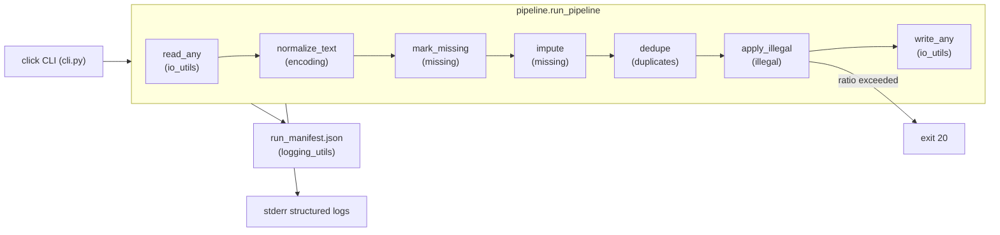

# 设计文档（DESIGN）

本文档说明 `dataclean` 的架构、规则到代码的对应、关键设计选择与权衡。

---

## 1. 架构总览

每个阶段都是纯函数：**输入 DataFrame + Rule → (DataFrame, stats dict)**。这使：

- 单元测试简单（不需要 CLI 或文件系统）
- 阶段统计直接汇入 manifest
- 未来可以替换/新增阶段而不改 CLI 层

---

## 2. 规则 → 代码对照

| YAML 字段 | 代码位置 | 说明 |
|---|---|---|
| `encoding_normalize` | `cleaners/encoding.py::normalize_text` | 对所有 object/string 列应用 `unicodedata.normalize("NFKC", s)`，再 `strip()` + `re.sub(r"\s+", " ", ...)` 折叠空白 |
| `missing.markers` | `cleaners/missing.py::mark_missing` | `series.where(~series.isin(markers), np.nan)` |
| `missing.strategy[col]` | `cleaners/missing.py::_impute_column` | `median`/`mean` 用 `pd.to_numeric(..., errors="coerce")` 得到数值后 `fillna`；`mode` 用 `series.mode().iloc[0]`；`constant` 用配置常量；`drop_row` 在上层 `dropna(subset=...)` |
| `duplicates.subset` / `keep` | `cleaners/duplicates.py::dedupe` | `df.duplicated(subset=subset, keep=keep)`；`keep="false"` 字符串被规范化为 Python `False`（删除全部重复） |
| `schema.columns[c].dtype` | `cleaners/illegal.py::_coerce_dtype` | `int` 用 `to_numeric` + 剔除小数部分；`float` 直接 `to_numeric`；`bool` 用显式映射表；非数值情况保留为 object |
| `schema.columns[c].range` | `cleaners/illegal.py::_check_column` | `(numeric < lo) \| (numeric > hi)` 掩码 |
| `schema.columns[c].enum` | 同上 | `~series.isin(enum)` |
| `schema.columns[c].regex` | 同上 | `pattern.fullmatch(x)` |
| `illegal.on_violation` | `apply_illegal` | `coerce` → `where(~violations, NaN)`；`drop` → 记录行掩码并最终丢弃；`fail` → 任何违规立即抛 `IllegalRatioExceeded` |
| `illegal.max_ratio` | 同上 | `total_violations / (rows * checked_cols)`；超过阈值抛 `IllegalRatioExceeded`（映射到 exit 20） |

---

## 3. 关键设计选择与权衡

### 3.1 全部按字符串读入 CSV
`read_csv(..., dtype=str, keep_default_na=False)`：
- **好处**：缺失标记（如 `?`）保持原样，由 `mark_missing` 显式控制；非法值能被精确定位（而不是 pandas 偷偷把 `"abc"` 变 NaN）。
- **代价**：每列类型由 `illegal.dtype` 的 `_coerce_dtype` 显式转换，稍慢但可控。

### 3.2 阶段顺序 encoding → missing → dedupe → illegal
- 先做文本规范化，可以保证"看起来相同"的字符串在后续能被正确识别为缺失/重复。
- 去重放在填补之后：填补过的记录才能和"干净"的记录正确比对。
- 非法值检测放最后：此时数据类型最接近"目标状态"，违规判断最准。

### 3.3 阈值保护（max_ratio）
纯粹的 `coerce` 可能悄悄把大量数据变成 NaN；`max_ratio` 把这种"沉默失败"升级为显式失败（退出码 20），便于下游管道感知。

### 3.4 Run Manifest
`run_manifest.json` 的三条 SHA-256（input、output、config）+ 库版本保证了"同样输入 + 同样配置 + 同样版本 → 同样输出"的可验证性。它既是审计痕迹，也是 CI 做回归比对的基础。

### 3.5 退出码
从 0/1/2 这种"模糊错误"扩展到 10/11/12/13/20/30 的分段，使脚本可以根据失败类型做不同处理（重试 / 告警 / 放弃）。

---

## 4. 已知局限

- 不支持流式处理（整表加载到内存），对 >GB 级 CSV 需要迁移到 `polars` 或 `chunk` 模式。
- 填补策略目前都是列独立；跨列条件填补（例如基于分组的中位数）需要扩展 `impute`。
- 非法值统计以"单元格级"而非"行级"为分母，便于横向比较但对宽表略偏乐观。
- 未内置时间列专门清洗（如多格式日期归一化），当前依赖 `regex` 做形式校验。

---

## 5. 可扩展点

- 新阶段：在 `cleaners/` 下新增模块，返回 `(df, stats)`，然后在 `pipeline.run_pipeline` 的编排函数中按顺序插入；manifest 会自动纳入其 stats。
- 新 dtype：在 `rules.SUPPORTED_DTYPES` 注册，并在 `_coerce_dtype` 加分支。
- 新输入格式：在 `io_utils.infer_format` / `read_any` / `write_any` 中增加分支（如 `parquet`、`xlsx`）。
